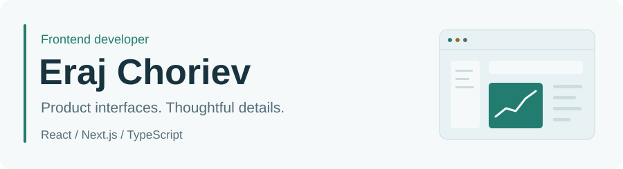
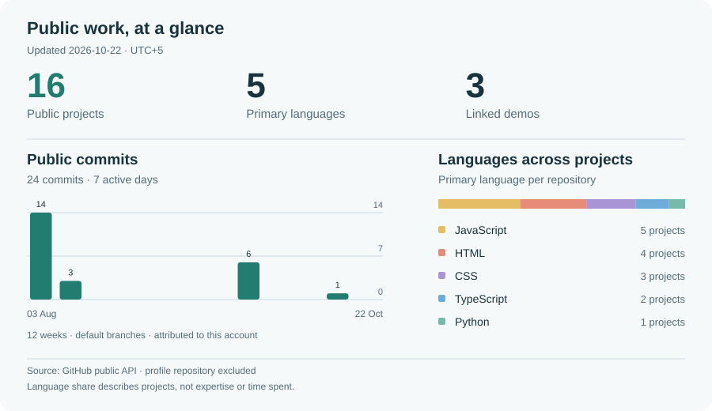

<picture>
  <source media="(max-width: 600px) and (prefers-color-scheme: dark)" srcset="assets/intro-dark-mobile.svg">
  <source media="(max-width: 600px)" srcset="assets/intro-light-mobile.svg">
  <source media="(prefers-color-scheme: dark)" srcset="assets/intro-dark.svg">
  
</picture>

I build product interfaces, dashboards, and web experiences with **React, Next.js, and TypeScript**. My public work includes an EV charging station finder, an AI usage dashboard interface, and bilingual landing pages.

[Browse my projects](https://github.com/Eraj-Choriev?tab=repositories) · [Recent public activity](https://github.com/Eraj-Choriev?tab=overview)

## Selected projects

### [Aqly](https://github.com/Eraj-Choriev/saas-landing)

Bilingual AI agency landing with reusable components and motion.

Next.js · TypeScript · Tailwind · Motion [Live preview](https://saaslanding-rosy.vercel.app) · [Source code](https://github.com/Eraj-Choriev/saas-landing)

### [Neru](https://github.com/Eraj-Choriev/neru-v2)

EV charging station finder for Dushanbe, with a map-based interface.

JavaScript · Maps · Progressive web app [Live preview](https://neru-v2.vercel.app) · [Source code](https://github.com/Eraj-Choriev/neru-v2)

### [Token Lens](https://github.com/Eraj-Choriev/token-lens)

AI usage dashboard interface with charts, analytics and account screens.

React · Vite · Recharts · Firebase [Live preview](https://parcel-one-blond.vercel.app) · [Source code](https://github.com/Eraj-Choriev/token-lens)

## Development dashboard

<picture>
  <source media="(max-width: 600px) and (prefers-color-scheme: dark)" srcset="assets/dashboard-dark-mobile.svg">
  <source media="(max-width: 600px)" srcset="assets/dashboard-light-mobile.svg">
  <source media="(prefers-color-scheme: dark)" srcset="assets/dashboard-dark.svg">
  
</picture>

Updated daily from public GitHub data. The chart counts commits attributed to this account on public project default branches; it is a different measure from the contribution calendar. [How the numbers are calculated](docs/METRICS.md).

View dashboard data as text

As of **2026-10-27**, Asia/Dushanbe: **16** public projects, **3** repositories with linked demos, **10** public default-branch commits from 2026-08-10 to 2026-10-27, across **5** active days.

| Primary language | Projects |
| :--- | ---: |
| JavaScript | 5 |
| HTML | 4 |
| CSS | 3 |
| TypeScript | 2 |
| Python | 1 |

[Public data snapshot](data/public.json) · [Automatic refresh](https://github.com/Eraj-Choriev/Eraj-Choriev/actions/workflows/profile.yml)

## Tools I work with

**Interfaces** — React, Next.js, TypeScript, JavaScript, HTML, CSS 
**Styling & motion** — Tailwind CSS, Framer Motion, Lucide 
**Data & visualization** — Firebase, Recharts, Python 
**Workflow** — Git, GitHub, Vite, Vercel

Every featured project links to source code and a live preview. Statistics use public repositories only.
